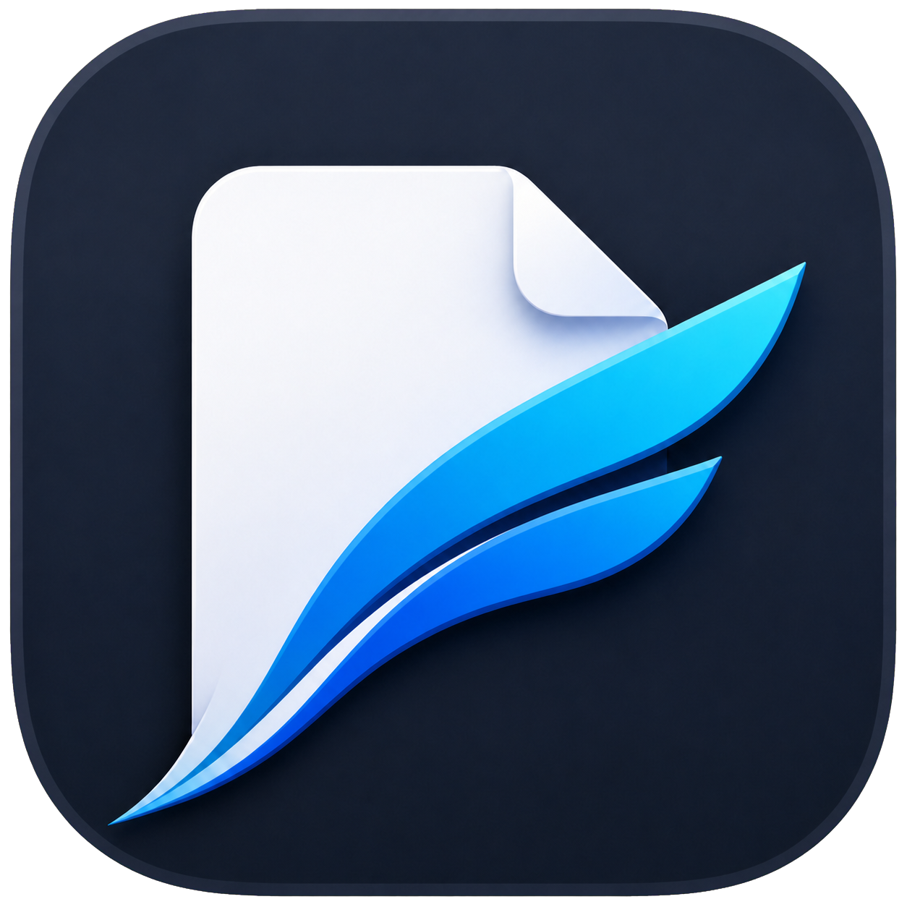

# PDFlight AI

<p align="center">
  
</p>

<p align="center">
  <strong>English</strong> · <a href="README.zh-CN.md">简体中文</a>
</p>

PDFlight AI is a native macOS PDF reader with an **Ask PDF** workspace. The reader uses AppKit and MuPDF; the sidebar embeds the PDF-reading conversation from the local DeepSeek Harness, including its theme, sessions, models, and reading prompts.

Current features:

- continuous vertical scrolling with visible-page rendering;
- an always-available native library sidebar with one width synchronized across every open paper, unlimited nested collections, display aliases, search, drag-to-file papers, and one-click paper switching;
- a hierarchical document outline with page-number navigation, available beside the library;
- a 12 MiB MuPDF store limit and a byte-bounded 12 MiB rendered-page cache per document;
- inactive windows release text, rendered pages, and MuPDF caches after five seconds;
- selectable/copyable PDF text;
- selection-first highlighting from the toolbar or Command-E, without switching tools;
- full-document search with result navigation and page highlights;
- password-protected PDF opening;
- internal PDF links with exact pre-link viewport restoration via Command-Left Arrow;
- external links through the default browser;
- reopening a PDF restores its last page, precise viewport position, and zoom;
- Retina rendering, fit-width, keyboard/pinch zoom, and nonblank progressive redraw while zooming;
- different PDFs grouped as tabs in one window by default;
- text-aligned highlights written back as standard PDF annotations;
- embedded PDF text-note annotations;
- Command-Z undo for the most recent highlight or text note;
- the actual DeepSeek Harness PDF-reading conversation as the **Ask PDF** sidebar, with per-paper session tabs, models, prompts, attachments, and the active Harness theme;
- direct save with a close-time unsaved-changes warning.

## Ask PDF

The sidebar embeds the PDF-reading panel from a running DeepSeek Harness Desktop. Install Harness with the `@local/pdf-reading-mode` plugin enabled. If the connection bridge has not been installed, choose **安装连接插件** in the sidebar; the bridge is also installable with `node scripts/install-harness-bridge.mjs`. It joins the existing desktop profile and does not start a separate Harness session store.

The current PDF is matched to a Harness library copy by content, or imported on first use. A saved source-path association keeps the conversation attached after the PDF is annotated. Harness manages models, sessions, rendering, reading prompts and its active theme; the sidebar keeps PDFlight's shared width and visibility. Use **Shift-Command-A** to hide or show it.

When an existing PDFlight history contains supported text messages, the bridge imports those messages into native Harness sessions when the paper is opened. Image attachments and unsupported record formats are left in the original `~/Library/Application Support/dev.pdflight.reader/ai-chats` files and the sidebar reports that the records were retained. Original files are never deleted. The embedded panel uses WebKit and shares the running Harness host, so its memory use differs from earlier native-sidebar releases.

## Paper library

The left sidebar opens to **Library** by default and can switch to the current PDF's **Outline**. Its width and visibility use the same workspace layout as every other paper: changing either sidebar updates all existing windows, future papers, and the next launch. **Recent** lists PDFs in true last-opened order; the File menu also provides **Open Recent** and **Clear Menu**. Create collections and subcollections to any depth, add PDFs, search by display name, file name, or path, press Return/double-click to open papers, and Command/Shift-select several papers before dragging or moving them to another collection. Names matching `Author - 2026 - Paper title` automatically display as `Paper title`. Use **Edit display name…** in a paper's context menu to set a custom alias without renaming the PDF; clear it to restore the automatic name. Opened PDFs are indexed automatically under Unfiled. Enable **Restore Last Session at Launch** in the application menu to reopen the PDFs that were still open when PDFlight quit. The library and last session are stored as portable, pretty-printed JSON under `~/Library/Application Support/dev.pdflight.reader/`; removing a library entry never deletes the PDF itself.

## Download

Download the latest Apple Silicon build from [GitHub Releases](https://github.com/Yuqin-G/pdflight-ai/releases/latest). PDFlight requires macOS 14 or later. The current open-source build is ad-hoc signed; on first launch, use **Control-click → Open** if macOS asks you to confirm the unidentified developer.

## Build

Requirements: macOS 14 or later, Apple Command Line Tools, Git, and an internet connection for the first MuPDF checkout.

```sh
./Scripts/build-app.sh
open ./dist/PDFlight.app
```

The build script checks out MuPDF 1.28.2 and compiles only the native libraries needed by PDFlight. EPUB/HTML, XPS, SVG, JavaScript, OCR, and barcode support are not included. The `tofu` build keeps Base 14 and CJK fallback fonts while omitting unrelated fallback fonts.

To install the local build:

```sh
ditto ./dist/PDFlight.app /Applications/PDFlight.app
```

To make it the default PDF reader with [`duti`](https://github.com/moretension/duti):

```sh
duti -s dev.pdflight.reader com.adobe.pdf viewer
duti -s dev.pdflight.reader com.adobe.pdf editor
duti -s dev.pdflight.reader com.adobe.pdf shell
```

## Shortcuts

| Action | Shortcut |
| --- | --- |
| Open | Command-O |
| Save | Command-S |
| Undo last annotation | Command-Z |
| Copy selected text | Command-C |
| Search | Command-F |
| Next/previous result while in search field | Return / Shift-Return |
| Next/previous search result | Command-G / Shift-Command-G |
| Move caret while editing search or chat text | Left/Right Arrow |
| Previous/next page | Left/Right Arrow |
| Back after following a link | Command-Left Arrow |
| Zoom | Command-Plus/Minus |
| Fit width | Command-0 |
| Highlight selected text | Command-E |
| Find the current paper and its citing-paper entry on Google Scholar | Toolbar graduation-cap button |
| Show/hide Ask PDF | Shift-Command-A |
| AI settings | Command-Comma |
| Text-note mode | N |

## Architecture

`DocumentEngine` is the document seam: page inspection, document outlines, text extraction, search, rendering, links, annotations, passwords, memory release, and save. `MuPDFDocument` is the first adapter. `RenderScheduler` owns in-flight request coalescing and a byte-bounded LRU cache. `DocumentCanvasView` virtualizes page bitmaps by retaining rendered content only near the viewport. `ReadingPositionStore` and `PaperLibraryStore` atomically persist local JSON. `PDFlightAI` contains explicit request construction, OpenAI-compatible streaming, Keychain configuration, and per-PDF chat persistence. AppKit only talks to those interfaces.


## License

PDFlight is released under AGPL-3.0-or-later because it links MuPDF. See `LICENSE` and MuPDF's notices under `Vendor/mupdf`.
