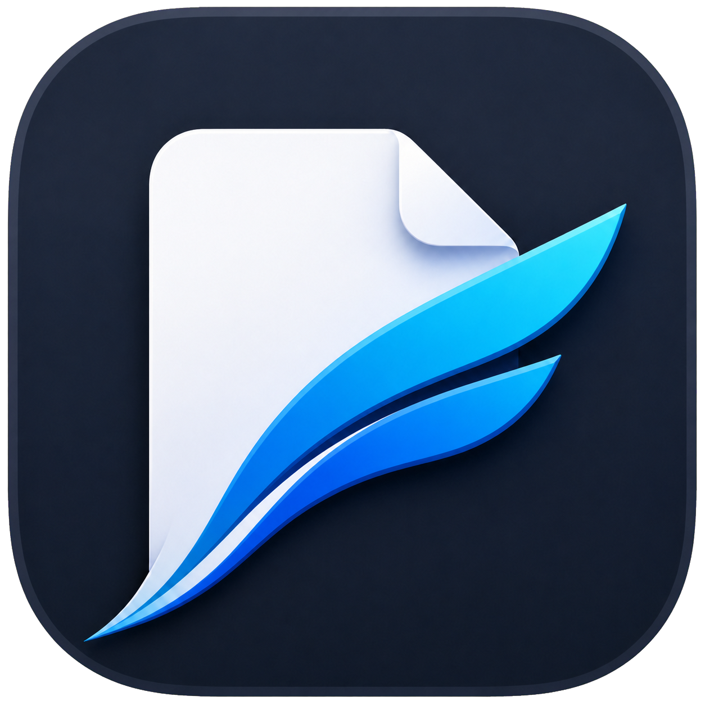

# PDFlight

<p align="center">
  
</p>

<p align="center">
  <a href="README.md">English</a> · <strong>简体中文</strong>
</p>

PDFlight 是一款面向论文阅读的轻量级原生 macOS PDF 阅读器。它使用 AppKit 界面和仅启用 PDF 的 MuPDF 构建，不依赖 PDFKit 的 `PDFView`，也不使用网页视图。

> [!NOTE]
> **内存基准：**打开 10 个 PDF 时，PDFlight 平均占用 **165.2 MiB**，Skim 为 **934.6 MiB**；打开 30 个 PDF 时，PDFlight 平均占用 **338.2 MiB**，Skim 为 **2,595.6 MiB**。PDFlight 的稳定物理内存占用降低了 **82.3%–87.0%**。完整测试方法和原始数据见 [BENCHMARK.md](BENCHMARK.md)；这是多文档静置测试，不是连续滚动压力测试。

当前功能：

- 连续垂直滚动，并且只渲染可见页面附近的内容；
- 原生层级目录侧栏和页码跳转；
- 每个文档限制为 12 MiB 的 MuPDF store，以及按字节限制为 12 MiB 的渲染页面缓存；
- 非活动窗口在五秒后释放文本、渲染页面和 MuPDF 缓存；
- PDF 文字选择和复制；
- 选中文字后通过工具栏或 Command-E 直接高亮，无需切换工具模式；
- 全文搜索、结果跳转和页面高亮；
- 支持密码保护的 PDF；
- PDF 内部链接跳转，并可通过 Command-左方向键精确返回跳转前位置；
- 外部链接通过默认浏览器打开；
- 重新打开 PDF 时恢复上次页码、精确阅读位置和缩放比例；
- Retina 渲染、适合宽度、键盘/触控板缩放，以及缩放时的非空白渐进重绘；
- 不同 PDF 默认以标签页形式放在同一窗口；
- 将文字对齐高亮写回为标准 PDF 批注；
- 内嵌 PDF 文字备注批注；
- Command-Z 撤销最近一次高亮或文字备注；
- 直接保存，并在关闭存在未保存修改的文档时提示。

## 下载

从 [GitHub Releases](https://github.com/Yuqin-G/pdflight/releases/latest) 下载最新的 Apple Silicon 构建。PDFlight 要求 macOS 14 或更高版本。当前开源构建使用 ad-hoc 签名；如果 macOS 首次启动时提示无法确认开发者，请按住 Control 点击应用并选择“打开”。

## 构建

要求：macOS 14 或更高版本、Apple Command Line Tools、Git，以及首次检出 MuPDF 时可用的网络连接。

```sh
./Scripts/build-app.sh
open ./dist/PDFlight.app
```

构建脚本会检出 MuPDF 1.28.2，并且只编译 PDFlight 所需的原生库。EPUB/HTML、XPS、SVG、JavaScript、OCR 和条形码功能不会被包含。`tofu` 构建保留 Base 14 与中日韩字体回退，同时省略无关的回退字体。

安装本地构建：

```sh
ditto ./dist/PDFlight.app /Applications/PDFlight.app
```

使用 [`duti`](https://github.com/moretension/duti) 将其设置为默认 PDF 阅读器：

```sh
duti -s dev.pdflight.reader com.adobe.pdf viewer
duti -s dev.pdflight.reader com.adobe.pdf editor
duti -s dev.pdflight.reader com.adobe.pdf shell
```

## 快捷键

| 操作 | 快捷键 |
| --- | --- |
| 打开 | Command-O |
| 保存 | Command-S |
| 撤销最近一次批注 | Command-Z |
| 复制所选文字 | Command-C |
| 搜索 | Command-F |
| 搜索框内下一条/上一条结果 | Return / Shift-Return |
| 下一条/上一条搜索结果 | Command-G / Shift-Command-G |
| 上一页/下一页 | 左/右方向键 |
| 链接跳转后返回 | Command-左方向键 |
| 缩放 | Command-加号/减号 |
| 适合宽度 | Command-0 |
| 高亮所选文字 | Command-E |
| 文字备注模式 | N |

## 架构

`DocumentEngine` 是文档 seam，负责页面检查、目录、文字提取、搜索、渲染、链接、批注、密码、内存释放和保存。`MuPDFDocument` 是第一个 adapter。`RenderScheduler` 负责合并进行中的相同请求，并维护按字节限制的 LRU 缓存。`DocumentCanvasView` 通过只保留视口附近的渲染内容实现页面位图虚拟化。AppKit 仅通过这些 interface 与底层交互。`ReadingPositionStore` 使用原子 JSON 文件保存最近文档的阅读位置。

## 性能测试

参阅 [`BENCHMARK.md`](BENCHMARK.md)。其中包含使用 macOS physical footprint、等待 10 秒稳定期后得到的 10/30 PDF 可复现对比、原始试验结果和完整方法。

## 许可证

由于链接了 MuPDF，PDFlight 使用 AGPL-3.0-or-later 许可证发布。详见 `LICENSE` 和 `Vendor/mupdf` 下的 MuPDF 声明。
